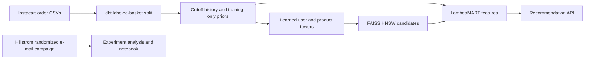

# commerce-ml-platform

I use this project to connect retail data modeling with next-basket recommendations. Instacart orders pass through dbt history tables, a learned two-tower retriever, FAISS candidate search and a LambdaMART ranker before reaching an HTTP API.



| Module | Data and purpose |
|---|---|
| [Warehouse](warehouse/README.md) | Full Instacart CSVs; dbt creates temporal user/product/category features |
| [Recommendations](recsys/README.md) | The same grocery baskets and dbt features; learned retrieval, ranking and serving |
| [Experiments](experiments/README.md) | Separate 64,000-customer Hillstrom experiment; intervals, CUPED and sequential monitoring |

```bash
./scripts/run_all.sh
```

With the dependencies installed, this builds the cutoff tables, trains and evaluates the models, runs the contracts, executes the Hillstrom notebook and benchmarks a temporary recommendation service. Existing CSVs are reused. Set `REUSE_FEATURES=1` for an unchanged warehouse or `BENCH_API=0` to omit the HTTP measurement. Model checkpoints are reused only when the recorded split and fit configuration match.

## Results

<!-- RESULTS -->

Full-data run: **206,209 users, 49,688 products and 33,819,106 labeled order lines**. The test baskets contain 2,165,417 positives across all 206,209 users.

| Method | Next-basket NDCG@10 | Recall@10 | Candidate Recall@100 |
|---|---:|---:|---:|
| Training popularity | 0.09762 | 0.06994 | 0.21754 |
| Two-tower + HNSW | 0.10023 | 0.08611 | 0.31730 |
| Two-tower + LambdaMART | 0.30336 | 0.22277 | 0.31730 |

Validation candidate Recall@100: 0.31624 macro / 0.28810 micro. LambdaMART fits 185,588 user groups and monitors 20,621 disjoint groups for early stopping. The selected model has 117 trees from a 120-round cap. HNSW's exact top-100 agreement is 0.98454 on a seeded 2,000-user diagnostic.

3 CPU epochs used every one of the 29,524,435 training purchase rows per epoch. These are elapsed execution records: two-tower fitting 429.3s, ranker fitting 101.6s. The full quality evaluation above uses every eligible user; the separate ANN diagnostic is explicitly smaller.

**HTTP:** 5,000/5,000 validated responses, zero errors, concurrency 8, after 50 excluded warmups. Client p50/p95/p99: 69.21/129.73/363.73ms; handler p50/p95/p99: 0.82/1.06/2.38ms. Throughput 56.0 requests/s.

The HTTP run used one Uvicorn worker, one FAISS/LightGBM thread per call and 8 closed-loop clients on an i7-12700KF under WSL2. The client timer ends at complete response-body arrival; the handler timer covers retrieval, feature lookup, reranking and item construction. The recorded WSL process snapshot contained only the task keepalive before launch. [Environment](results/environment.json) · [WSL process snapshot](results/api-background-processes.txt).

[Full metrics and fit provenance](results/metrics.json) · [every HTTP request](results/api_bench.json) · [split and feature hashes](results/dataset.json).

## What the split means

Only orders with supplied item rows define labels. Each user's last labeled basket is test, the penultimate basket is validation, and earlier baskets form training history. Users with fewer than three labeled baskets are explicitly excluded. Unlabeled Kaggle test orders are counted separately.

Validation features use training history. Test features add that user's completed validation basket. Product popularity, reorder priors and all feature normalizers stay fixed at training. Reorders remain eligible candidates. Recall divides retrieved positives by the complete held-out basket; NDCG uses an ideal list of `min(k, basket size)`, then both metrics average over users.

The two towers learn from training purchase rows and dbt history/metadata features. LambdaMART uses validation candidates, split into disjoint user groups for fitting and early stopping. Test labels enter only the final evaluation. Candidate-positive coverage is reported separately from the final top-ten ranking.

Hillstrom is an independent randomized e-mail dataset. Its measured treatment effects belong to that campaign; it is not an online experiment on these recommendations.

## Setup and sources

The local checks passed nine recommendation contracts, two warehouse fixture cases and 18 Hillstrom cases. The Hillstrom notebook executed six cells with zero errors and matched its analysis outputs. [dbt checks](results/dbt-validation.json) · [recommendation tests](results/fixture-tests.log) · [warehouse fixtures](results/warehouse-tests.log) · [experiment execution](results/experiments.log).

Python 3.12 and Linux are used locally and in [the unified workflow](https://github.com/kianbqh/commerce-ml-platform/actions/workflows/commerce.yml).

```bash
python3 -m venv .venv
source .venv/bin/activate
pip install torch --index-url https://download.pytorch.org/whl/cpu
pip install -r requirements.txt
./scripts/run_all.sh
```

The six Instacart 2017 CSVs come from the [public dataset mirror](https://huggingface.co/datasets/attik/Instacart-Market-Basket-Analysis). [Source file hashes](results/before/warehouse/data_manifest.json) identify the full input. Runtime arrays, database and models stay in ignored local directories; reports contain counts, split checksums, raw HTTP samples and fitting provenance.

The warehouse, recommendation and experiment source histories were merged without squash. [History](docs/history.md) records their original commits. Earlier MovieLens results are archived in `results/before/movielens/`; current recommendation results use Instacart baskets.
