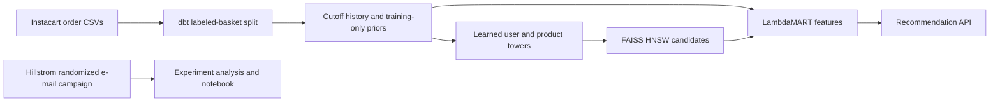
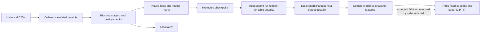

# commerce-ml-platform

I use this project to connect retail data modeling with next-basket recommendations. Instacart orders pass through dbt history tables, a learned two-tower retriever, FAISS candidate search and a LambdaMART ranker before reaching an HTTP API.



| Module | Data and purpose |
|---|---|
| [Warehouse](warehouse/README.md) | Full Instacart CSVs; dbt creates temporal user/product/category features |
| [Recommendations](recsys/README.md) | The same grocery baskets and dbt features; learned retrieval, ranking and serving |
| [Experiments](experiments/README.md) | Separate 64,000-customer Hillstrom experiment; intervals, CUPED and sequential monitoring |
| [Arrival replay](orchestration/README.md) | Simulated receipts, keyed corrections, blocking checks and terminal feature export |
| [Local Spark](spark/README.md) | Physical Parquet partitions and exact read-back against dbt |

The original recommendation workflow remains available:

```bash
./scripts/run_all.sh
```

With the dependencies installed, this builds the cutoff tables, trains and evaluates the models, runs the contracts, executes the Hillstrom notebook and benchmarks a temporary recommendation service. Existing CSVs are reused. Set `REUSE_FEATURES=1` for an unchanged warehouse or `BENCH_API=0` to omit the HTTP measurement. Model checkpoints are reused only when the recorded split and fit configuration match.

## Manual arrival replay and local Spark

I wanted to see how incremental loading behaves once corrections and exact
data checks are included. Historical Instacart baskets pass through Dagster/dbt
arrival batches, a promoted checkpoint, independent full-refresh comparison
and physical local Spark Parquet read-back. Receipt dates, delayed receipts
and corrections are simulated; the grocery baskets are historical records.
I use the inputs locally under the [Dataset Terms](https://gist.github.com/jeremystan/582eba13d6ee27ed465c43dc78934700).
Historical CSVs and real subsets are not redistributed. CI generates independent
synthetic baskets.



The accepted data-only parent processed **33,819,106 labeled
lines** from 3,346,083 labeled orders, across
206,209 users and ten ordered batches. There are
3,421,083 metadata orders including
unlabeled baskets. The catalog contains **49,688 products**; **49,685** actually
appear in the labeled lines.

| Parent measurement | Recorded result |
|---|---:|
| Full-refresh dbt build and tests | 31.870717 s |
| Ten first-arrival dbt builds and tests, sum | 342.093988 s |
| Separate exact source/fact quality audits, sum | 5,748.411023 s |
| Separate partition digests, sum | 2,156.243612 s |
| Original Spark processing, excluding physical hashes | 150.113704 s |
| Original Parquet | 599 files; 255,826,620 bytes |
| Original Parquet read-back and exact comparison | 1,225.006004 s |

The ten incremental ETL/test processes took 10.734 times the single
full-refresh ETL/test process. Cumulative scans and the extra exact audits made
this a correctness study, not an ETL speedup. Audit/export timers above are
separate from ETL; the repeated-batch demonstration is excluded from its sum.
These are one-repetition elapsed records on the documented WSL2 host.

The original, corrected and recovered DBs passed all six named table comparisons.
Both Spark passes passed all four outputs. Corrections changed only batches
`000000`/`000001`; eight other batch digests stayed equal. The injected product
FK error blocked promotion, and a fresh clean run recovered. Nine nonterminal
prefixes had no recommendation relations or feature export.

[Summary](results/orchestration/full-20261103/summary.json) · [aggregate counts](results/orchestration/full-20261103/aggregate-counts.json) · [parent supplement](results/orchestration/full-20261103/parent-supplement.json) · [per-batch CSV](results/orchestration/full-20261103/build-timings.csv) · [Delivery report](results/M4_DELIVERY_REPORT.md).

The [orchestration guide](orchestration/README.md) gives the complete
`commerce_all` entry and the selected-child reuse entry. The accepted parent's
model/API receipts remain `not run`. Its append-only child uses the same terminal
DB/cache without another data export: seeds 42/43/44, three epochs, 120 ranker
rounds, 100 candidates and seed-42 serving for 5,000 measured HTTP requests after
50 warmups at concurrency 8. The child completed all three CPU fits and both selected Dagster assets.
The accepted parent DB/cache and its twelve tracked receipts stayed unchanged.
Each seed saw all 29,524,435 training positives in every epoch.

| Method | NDCG@10 | Recall@10 | Candidate Recall@100 |
|---|---:|---:|---:|
| Training popularity | 0.097616 ± 0.000000 | 0.069942 ± 0.000000 | 0.217538 ± 0.000000 |
| Two-tower + HNSW | 0.099415 ± 0.000640 | 0.085524 ± 0.000573 | 0.316579 ± 0.000528 |
| Two-tower + LambdaMART | 0.302808 ± 0.000473 | 0.222243 ± 0.000454 | 0.316579 ± 0.000528 |

Values are mean ± population std over model seeds 42/43/44; evaluation uses all
206,209 test baskets. [Child summary](results/orchestration/full-20261103/downstream/summary.json) · [all user-ID-free HTTP timing samples](results/orchestration/full-20261103/downstream/http-timings.json) · [extraction/source identities](results/orchestration/full-20261103/downstream/extraction-manifest.json).

HTTP returned **5,000/5,000 valid responses**, zero errors, after 50 excluded
warmups with concurrency 8 and seed-42 serving. Client p50/p95/p99:
**52.759895/202.528091/375.415107 ms**;
handler: 0.770786/2.544492/3.353868 ms.
Measured load took 48.018628 s (104.126258 requests/s).
Client time ends at full response-body arrival; handler time covers retrieval,
features, reranking and item construction. The owned service shut down cleanly.

[Dashboard](results/orchestration/full-20261103/dashboard/index.html) · [snapshot](results/orchestration/full-20261103/dashboard/snapshot.json) · [browser checks](results/orchestration/full-20261103/dashboard/browser-validation.json) · [desktop](results/orchestration/full-20261103/dashboard/desktop.png) · [narrow](results/orchestration/full-20261103/dashboard/narrow.png). Actual Windows headless Chromium checks passed at desktop
1440 and narrow 390 pixels, including all values, lineage, refresh, JSON-link
export, no whole-page horizontal overflow and zero page/console errors or external
request attempts. Both the private exact-byte and sanitized public views were
checked. The existing Results below remain the earlier completed experiment.

[CI 41601768167](https://github.com/kianbqh/commerce-ml-platform/actions/runs/41601768167)
passed all five jobs at `f6572128`. Its 181 independent synthetic lines exercised
three batches, corrections/failure/recovery, exact Spark parity, three tiny CPU
fits and 20 real HTTP responses. The offline artifact audit passed 41/41 checks.
Those toy values/timings are correctness evidence, not full-data performance.
This remains one-machine DuckDB/local Spark with simulated arrivals and local
alerts; GCP and production/live CDC are outside this run.

## Results

<!-- RESULTS -->

Full-data run: **206,209 users, 49,688 products and 33,819,106 labeled order lines**. The test baskets contain 2,165,417 positives across all 206,209 users.

| Method | Next-basket NDCG@10 | Recall@10 | Candidate Recall@100 |
|---|---:|---:|---:|
| Training popularity | 0.09762 | 0.06994 | 0.21754 |
| Two-tower + HNSW | 0.10023 | 0.08611 | 0.31730 |
| Two-tower + LambdaMART | 0.30336 | 0.22277 | 0.31730 |

Validation candidate Recall@100: 0.31624 macro / 0.28810 micro. LambdaMART fits 185,588 user groups and monitors 20,621 disjoint groups for early stopping. The selected model has 117 trees from a 120-round cap. HNSW's exact top-100 agreement is 0.98454 on a seeded 2,000-user diagnostic.

3 CPU epochs used every one of the 29,524,435 training purchase rows per epoch. These are elapsed execution records: two-tower fitting 429.3s, ranker fitting 101.6s. The full quality evaluation above uses every eligible user; the separate ANN diagnostic is explicitly smaller.

**HTTP:** 5,000/5,000 validated responses, zero errors, concurrency 8, after 50 excluded warmups. Client p50/p95/p99: 69.21/129.73/363.73ms; handler p50/p95/p99: 0.82/1.06/2.38ms. Throughput 56.0 requests/s.

The HTTP run used one Uvicorn worker, one FAISS/LightGBM thread per call and 8 closed-loop clients on an i7-12700KF under WSL2. The client timer ends at complete response-body arrival; the handler timer covers retrieval, feature lookup, reranking and item construction. The recorded WSL process snapshot contained only the task keepalive before launch. [Environment](results/environment.json) · [WSL process snapshot](results/api-background-processes.txt).

[Full metrics and fit provenance](results/metrics.json) · [every HTTP request](results/api_bench.json) · [split and feature hashes](results/dataset.json).

## What the split means

Only orders with supplied item rows define labels. Each user's last labeled basket is test, the penultimate basket is validation, and earlier baskets form training history. Users with fewer than three labeled baskets are explicitly excluded. Unlabeled Kaggle test orders are counted separately.

Validation features use training history. Test features add that user's completed validation basket. Product popularity, reorder priors and all feature normalizers stay fixed at training. Reorders remain eligible candidates. Recall divides retrieved positives by the complete held-out basket; NDCG uses an ideal list of `min(k, basket size)`, then both metrics average over users.

The two towers learn from training purchase rows and dbt history/metadata features. LambdaMART uses validation candidates, split into disjoint user groups for fitting and early stopping. Test labels enter only the final evaluation. Candidate-positive coverage is reported separately from the final top-ten ranking.

Hillstrom is an independent randomized e-mail dataset. Its measured treatment effects belong to that campaign; it is not an online experiment on these recommendations.

## Setup and sources

The local checks passed nine recommendation contracts, two warehouse fixture cases and 18 Hillstrom cases. The Hillstrom notebook executed six cells with zero errors and matched its analysis outputs. [dbt checks](results/dbt-validation.json) · [recommendation tests](results/fixture-tests.log) · [warehouse fixtures](results/warehouse-tests.log) · [experiment execution](results/experiments.log).

Python 3.12 and Linux are used locally and in [the unified workflow](https://github.com/kianbqh/commerce-ml-platform/actions/workflows/commerce.yml).

```bash
python3 -m venv .venv
source .venv/bin/activate
pip install torch --index-url https://download.pytorch.org/whl/cpu
pip install -r requirements.txt
./scripts/run_all.sh
```

The six Instacart 2017 CSVs are used locally under the [Dataset Terms](https://gist.github.com/jeremystan/582eba13d6ee27ed465c43dc78934700). Historical CSVs and real subsets are not distributed here; public CI generates independent synthetic baskets. [Source file hashes](results/before/warehouse/data_manifest.json) identify the full input. Runtime arrays, database and models stay in ignored local directories; reports contain counts, split checksums, raw HTTP samples and fitting provenance.

The warehouse, recommendation and experiment source histories were merged without squash. [History](docs/history.md) records their original commits. Earlier MovieLens results are archived in `results/before/movielens/`; current recommendation results use Instacart baskets.
