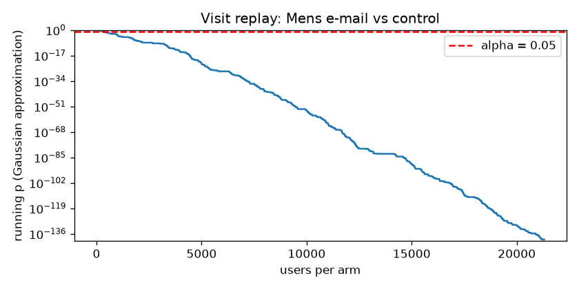
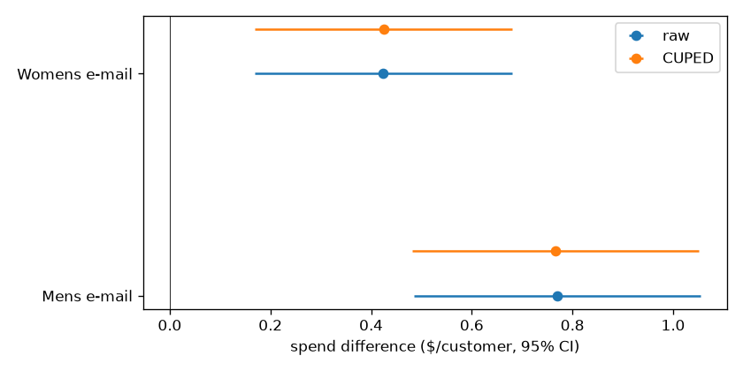

# Hillstrom experiment analysis

[](https://github.com/kianbqh/commerce-ml-platform/actions/workflows/commerce.yml)

This is the platform's separate experiment toolkit. The randomized e-mail campaign is independent of the Instacart recommendation dataset.

I used the Hillstrom / MineThatData e-mail campaign to work through a full experiment readout. I was especially interested in whether past customer activity narrows the intervals, and how repeated checks change the test's behavior.

The [public experiment](https://www.tensorflow.org/datasets/catalog/hillstrom) has 64,000 customers, randomly allocated to a Mens e-mail, a Womens e-mail, or no e-mail. Visits, purchases, and spend were recorded over the following two weeks. The compressed data is included in [`data/`](data/); the loader verifies its SHA-256 before reading it.

## What I measure

| Question | Method |
|---|---|
| Are assignment counts close to the planned equal split? | Sample-ratio mismatch chi-square check |
| What visit or conversion lift could this sample detect? | Normal-approximation power and sample-size calculations |
| How did each e-mail change outcomes? | Two-proportion z-tests for rates; Welch tests for spend; absolute and relative effects |
| How wide are the intervals? | Marginal 95% analytic intervals and 4,000 within-arm percentile bootstrap draws |
| What happens across all six comparisons? | Holm adjustment for two treatment arms × three metrics |
| Does pre-period activity improve precision? | Pooled CUPED with past spend alone and with all pre-period covariates |
| What changes when I keep checking? | Gaussian mSPRT replay and 400 A/A splits at 20 interim looks |

## Results from the local run

Run on 2026-11-01 with Python 3.12.3. Assignment counts were 21,306 control, 21,307 Mens e-mail, and 21,387 Womens e-mail; the equal-allocation check gives SRM p = 0.904. The data has no missing values.

| E-mail | Metric | Control → treatment | Absolute effect (95% CI) | Relative lift (bootstrap 95% CI) | Holm p |
|---|---|---|---|---|---|
| Mens | Visit | 10.62% → 18.28% | +7.66 pp [7.00, 8.32] | +72.1% [64.3%, 80.7%] | 3.41e-111 |
| Mens | Conversion | 0.573% → 1.253% | +0.681 pp [0.500, 0.861] | +118.8% [77.0%, 172.3%] | 6.09e-13 |
| Mens | Spend/customer | $0.653 → $1.423 | +$0.770 [0.485, 1.055] | +117.9% [63.6%, 194.4%] | 3.49e-7 |
| Womens | Visit | 10.62% → 15.14% | +4.52 pp [3.89, 5.16] | +42.6% [35.6%, 50.1%] | 1.59e-43 |
| Womens | Conversion | 0.573% → 0.884% | +0.311 pp [0.150, 0.472] | +54.3% [23.1%, 95.3%] | 3.14e-4 |
| Womens | Spend/customer | $0.653 → $1.077 | +$0.424 [0.169, 0.680] | +65.0% [21.8%, 127.9%] | 0.00113 |

Both e-mail arms have positive estimated effects across all three outcomes, and all six comparisons remain significant after Holm adjustment. At the observed control baseline and 21,306 customers per arm, the normal-approximation visit MDE is 0.84 pp at 80% power and a two-sided 5% level. A target +1 pp visit effect needs 15,504 customers per arm; a target +0.1 pp conversion effect needs 96,971.

CUPED adds a small precision gain here. The multivariate adjustment reduces visit residual variance by 2.9% for Mens and 2.6% for Womens, narrowing the intervals by 1.5% and 1.3%. Spend residual variance changes by less than 0.2%, so its intervals are almost unchanged.

The seeded visit replay first crosses p < 0.05 at 372 customers per arm, or 1.75% of the matched sample. On 400 independent control-group splits inspected at 20 looks:

| Procedure | Rejections | Rejection rate | 95% Monte Carlo interval |
|---|---:|---:|---:|
| Fixed horizon, one look | 18 / 400 | 4.50% | [2.69%, 7.02%] |
| Ordinary Welch test at every look | 88 / 400 | 22.00% | [18.04%, 26.38%] |
| Gaussian mSPRT approximation | 5 / 400 | 1.25% | [0.41%, 2.89%] |

The run passed all 18 tests and executed all six notebook code cells with no errors. Its numerical consistency assertions passed for every comparison.

The complete values, dataset checks, seeds, and package versions are in [the canonical results](../results/experiments/results.json). The [executed notebook](../results/experiments/notebooks/ab_test_readout.ipynb) walks through the calculation, and the [HTML readout](../results/experiments/notebooks/ab_test_readout.html) includes its tables and figures. [Provenance](../results/experiments/provenance.json) records each source output's SHA256 and its byte-identical canonical copy.

## Sequential replay

There are no arrival timestamps in this dataset, so I independently shuffle each arm with seed 42. The replay uses a fixed planning visit rate of 0.10 (`sigma2=0.09`) and an effect-prior standard deviation of 1 percentage point (`tau2=0.0001`). It uses only each observed prefix; future observations never determine its variance or prior.

The [Gaussian mSPRT result](https://arxiv.org/abs/1512.04922) assumes independent Gaussian streams with known common variance. Binary visits use the Gaussian approximation. The A/A rejection frequencies and their exact binomial Monte Carlo intervals describe calibration on random splits of this control group. The A/A simulation has a separate seed 43.



## CUPED

The adjustment uses covariates from before the campaign: past-year spend, recency, earlier product-line purchases, new-customer status, ZIP category, and channel. I fit the coefficients on the pooled treatment/control sample, then compare adjusted means with Welch intervals. The reported variance reduction is the in-sample residual reduction from that fit.



## Run it

I use Python 3.12 on Linux / WSL2. From the project directory:

```bash
python3 -m venv .venv
source .venv/bin/activate
python -m pip install -r requirements.txt
bash scripts/run_all.sh
```

That runs the tests and analysis, rebuilds and executes the notebook, exports HTML, and verifies that the notebook recomputes the report's fixed tests, bootstrap intervals, CUPED results, and sequential replay. The bootstrap and replay use seed 42. Both absolute and relative bootstrap intervals reuse the same resampling draws.

The script keeps caches and temporary files inside the project, and defaults to two numerical-library threads. It retains the module's `reports/` and `notebooks/` outputs, then synchronizes verified copies into the root `results/experiments/` directory. The root report command performs the same synchronization. Canonical outputs are:

| Output | Contents |
|---|---|
| [results.json](../results/experiments/results.json) | Effects, intervals, adjusted p-values, power, CUPED, A/A calibration, and environment |
| [figures/](../results/experiments/figures/) | Sequential replay and spend intervals |
| [ab_test_readout.ipynb](../results/experiments/notebooks/ab_test_readout.ipynb) | Executed calculations and consistency assertions |
| [ab_test_readout.html](../results/experiments/notebooks/ab_test_readout.html) | Standalone readout with embedded figures |
| [validation.json](../results/experiments/validation.json) | Executed-cell checks, figure dimensions, and artifact hashes |

GitHub Actions runs the same full pipeline and retains the generated reports. Tests cover SciPy/statsmodels parity, power calculations, CUPED on simulated data, SRM, bootstrap intervals, Gaussian mSPRT calibration and prefix independence, numerical stability, and dataset integrity.

The dataset was released through [Kevin Hillstrom's original challenge](https://blog.minethatdata.com/2008/03/minethatdata-e-mail-analytics-and-data.html). The bundled mirror is recorded in `abtest/data.py`, with SHA-256 `bab6578f60db5d792f1c2372c502f029152a5249cf5ea84390f3b7f885d7234f`.
