# Replaying grocery orders with Dagster and dbt

I use historical Instacart orders to study how a checked incremental warehouse
behaves as batches arrive, are corrected, fail validation and recover. Dagster
connects the dbt assets, blocking checks, local Spark export and terminal feature
export in one manually invoked pipeline.

Instacart supplies order numbers and elapsed-day offsets, not calendar event
timestamps. The baskets are real historical records. Daily receipt dates,
delayed receipts and correction metadata in this experiment are simulated.

```mermaid
flowchart LR
  CSV[Historical Instacart CSVs] --> R[Ordered simulated receipts]
  R --> S[Candidate staging]
  S --> Q[Blocking input checks]
  Q --> M[Keyed facts and operational marts]
  M --> O[Reconciliation and processing-freshness checks]
  O --> P[Promoted checkpoint]
  P --> F[Independent full refresh and six-table parity]
  F --> SP[Local Spark Parquet and read-back parity]
  SP --> T[Complete original-snapshot gate]
  T --> D[Terminal dbt recommendation assets]
  D --> X[Terminal feature export]
  X --> ML[Three fixed-seed fits and evaluation]
  ML --> API[Seed-42 HTTP asset]
  X -. accepted inputs reused by selected child .-> ML
  Q --> A[Local structured alert]
  O --> A
```



## Current measurement record

The data-only parent completed and passed independent review at source
`829250d93e5e436e98e4a5df41296b0d121a52a8`, run `913dbb54-c51d-49bf-a225-3741fe84d2d1`. Its model/API receipts remain `not run`; a separate
selected child supplies the later model/HTTP measurements.

The accepted data-only parent processed **33,819,106 labeled
lines** from 3,346,083 labeled orders, across
206,209 users and ten ordered batches. There are
3,421,083 metadata orders including
unlabeled baskets. The catalog contains **49,688 products**; **49,685** actually
appear in the labeled lines.

| Check or scope | Accepted parent result |
|---|---|
| Original, corrected and recovered DBs | Exact equality across the six tables below |
| First ordered replay / full refresh ETL + tests | 342.093988 s summed / 31.870717 s |
| Separate source/fact quality / partition digests | 5,748.411023 s / 2,156.243612 s summed |
| Repeated batch | `000009` unchanged; five partition-scoped tables over all ten batches |
| Corrected batches / unchanged batches | `000000`, `000001` / eight remaining batches |
| Bad-batch block / recovery | Intended product FK failed; promotion unchanged; fresh recovery passed |
| Terminal-only features | All nine nonterminal prefixes clear; final split/fingerprint matched baseline |
| Spark original / corrected | Four exact outputs each; actual `local[8]` and parallelism 8 |
| Selected child and combined browser | Three CPU seeds and 5,000 valid HTTP responses; private/public desktop+narrow checks passed |

[Summary](../results/orchestration/full-20261103/summary.json) · [aggregate counts](../results/orchestration/full-20261103/aggregate-counts.json) · [parent supplement](../results/orchestration/full-20261103/parent-supplement.json) · [per-batch CSV](../results/orchestration/full-20261103/build-timings.csv) · [delivery report](../results/M4_DELIVERY_REPORT.md).

The first ten ETL/test processes are 10.734 times the single full refresh;
this run did not show an incremental ETL speedup. The exact audits dominate its
elapsed work. One repetition is recorded; replay totals exclude idempotence and
correction attempts. The [CSV](../results/orchestration/full-20261103/build-timings.csv) separates every batch's
ETL, quality and digest timers.

## Accepted selected child

Run `5b083057-a84b-4c0a-b471-bec98aa04f12` at source
`f6572128dedbf03daebdb1fb398aa79f1dd5e8ce` reused the accepted parent terminal
DB/cache. All twelve small parent receipt hashes and the input DB/cache identity
were unchanged after execution. Exactly the two selected assets materialized.

| Method | NDCG@10 | Recall@10 | Candidate Recall@100 |
|---|---:|---:|---:|
| Training popularity | 0.097616 ± 0.000000 | 0.069942 ± 0.000000 | 0.217538 ± 0.000000 |
| Two-tower + HNSW | 0.099415 ± 0.000640 | 0.085524 ± 0.000573 | 0.316579 ± 0.000528 |
| Two-tower + LambdaMART | 0.302808 ± 0.000473 | 0.222243 ± 0.000454 | 0.316579 ± 0.000528 |

These are population mean/std over seeds 42/43/44. Each CPU fit used four threads
and three epochs of all 29,524,435 training positives. Ranker fitting used
185,588 user groups with 20,621 disjoint early-stop groups; selected trees were
117/97/120 from the same 120-round cap.

Seed-42 HTTP served 5,000 valid requests, zero errors, after 50 warmups at
concurrency 8. Client p50/p95/p99 were
52.759895/202.528091/375.415107 ms.
[Child summary](../results/orchestration/full-20261103/downstream/summary.json) · [all user-ID-free HTTP timing samples](../results/orchestration/full-20261103/downstream/http-timings.json) · [extraction/source identities](../results/orchestration/full-20261103/downstream/extraction-manifest.json). Actual model/HTTP elapsed times and per-seed values are
in that summary and the [delivery report](../results/M4_DELIVERY_REPORT.md).

[Dashboard](../results/orchestration/full-20261103/dashboard/index.html) · [snapshot](../results/orchestration/full-20261103/dashboard/snapshot.json) · [browser checks](../results/orchestration/full-20261103/dashboard/browser-validation.json) · [desktop](../results/orchestration/full-20261103/dashboard/desktop.png) · [narrow](../results/orchestration/full-20261103/dashboard/narrow.png).
The private and public views both passed actual Windows headless checks at
1440×1000 and 390×844, with exact displayed values, visible parent/child IDs,
refresh/JSON-link export, zero page/console errors, no external request attempt
and no whole-page horizontal overflow. Their owned browser/server resources
closed. The public view keeps values and control IDs while replacing native
paths and free-form alert text with safe metadata/labels.

## Setup and one-command materialization

Use Linux or WSL2, Python 3.12 and a Linux JDK 17 or later. Install the combined
orchestration, Spark and recommendation requirements in one isolated environment.
Torch comes from the official CPU index; retain the actual resolved version,
freeze and package check with each run.

```bash
export WORK=/mnt/g/m4-work/my-run
mkdir -p "$WORK"
python3.12 -m venv "$WORK/venv"
source "$WORK/venv/bin/activate"
python -m pip install torch --index-url https://download.pytorch.org/whl/cpu
python -m pip install -r orchestration/requirements-ci-training.txt
python -m pip check
python -m pip freeze > "$WORK/environment-freeze.txt"
export JAVA_HOME=/path/to/linux-jdk
export PATH="$JAVA_HOME/bin:$PATH"
export PYTHONDONTWRITEBYTECODE=1
export PYTHONPATH="$PWD/orchestration"
```

Copy [`config/full-models.json`](config/full-models.json) to
`"$WORK/full-models.json"`. Set `runtime_root` to your runtime directory and
`raw_dir` to the existing directory containing `orders.csv`,
`order_products__prior.csv`, `order_products__train.csv`, `products.csv`,
`aisles.csv` and `departments.csv`. Keep CSVs, DBs, Parquet, environments and
scratch outside Git. The measured local execution uses the G-backed WSL disk.

From the repository root, one manual command invokes the complete finite job:

```bash
export RUN="$WORK/runs/full-models-unique-id"
python orchestration/scripts/run_manual.py --config "$WORK/full-models.json" --run-root "$RUN"
```

`RUN` must not exist and must be below the configured `runtime_root`.
`--raw-dir` overrides the configured raw path. The runner hashes six source
files, scans order metadata, creates an arrival manifest and parses dbt before
loading definitions. `--definitions-only` stops before materialization but still
reads source data and runs `dbt parse`.

The full-model protocol fixes seeds 42/43/44, three epochs over all training
positives, 120 ranker rounds and 100 candidates. Mean/std use the three fixed
model seeds with population standard deviation (`ddof=0`). HTTP serves the
predeclared seed-42 model for 5,000 measured requests after 50 excluded warmups
at concurrency 8. The accepted child above used exactly these settings.

### Reuse a closed data-only parent

For a data-only run, use [`config/full.json`](config/full.json) with the same path
setup. Once it has completed and passed its original-snapshot, six-table and
Spark gates, select only the two downstream assets:

```bash
export PARENT=/path/to/accepted-data-only-run
export CHILD="$WORK/runs/downstream-unique-id"
python - "$PARENT/config.json" "$WORK/full-models-for-parent.json" <<'PY'
import json, sys
with open(sys.argv[1]) as source:
    config = json.load(source)
config["training_enabled"] = True
with open(sys.argv[2], "x") as target:
    json.dump(config, target, indent=2)
    target.write("\n")
PY
python orchestration/scripts/run_downstream.py \
  --parent-run-root "$PARENT" \
  --config "$WORK/full-models-for-parent.json" \
  --run-root "$CHILD"
```

The requested config must equal the parent's config except for
`training_enabled=true`. The fresh child must be below that configured runtime
root and outside the parent. It validates the closed data-only parent and uses
the original terminal database, feature cache and parsed dbt manifest. It does
not replay arrivals, export features or rebuild dbt/Spark. A changed accepted
input fails; there is no re-export fallback. Optional `--model-python PATH` uses
a separate existing fit/API interpreter while Dagster stays in the invoking
environment.

The selected job contains exactly `recsys_train_eval` and `api_benchmark`.
It retains its own model/API metrics, real events, accepted-input binding and
before/after verification. The parent's data-only receipts stay unchanged.

### Summaries and dashboard

For one complete `commerce_all` run:

```bash
python orchestration/scripts/summarize_run.py --run-root "$RUN"
python orchestration/scripts/build_dashboard.py --run-root "$RUN" --out "$WORK/dashboard-unique-id"
```

For a data-only parent and completed selected child:

```bash
python orchestration/scripts/summarize_run.py --run-root "$PARENT"
python orchestration/scripts/build_dashboard.py \
  --run-root "$PARENT" --downstream-root "$CHILD" \
  --out "$WORK/dashboard-with-child-unique-id"
```

`--downstream-root` verifies lineage and actual completion before combining the
view. Readers do not materialize assets. Outputs are create-only; refreshing
needs a new directory. The dashboard writes `index.html` and `snapshot.json`.
The schedule and alert sensor are defined stopped. No daemon or recurring task
is needed.

## Arrival, correction and promotion

A batch is `(order_number - 1) // orders_per_batch`. Full configuration uses
width 10; the fixture uses width 2. The actual partition list and row counts come
from the source metadata, not a hard-coded count. Each arrival exposes an ordered
prefix and starts from a copy of the last passing database.

`fct_order_lines` replaces existing `(order_id, product_id)` keys and `fct_orders`
replaces `order_id` keys through dbt `delete+insert`. A correction flips an existing
non-first-order line's `reordered` value in each selected batch. Basket totals and
integer marts update from those facts. The correction becomes visible only when
its partition is reprocessed; later corrections must not appear early. Deletes
and changes to primary keys are outside this contract.

The declared backfill range is `000000` through `000001`. Evidence must show the
selected partition digests changed, other partition digests stayed equal, both
facts changed where intended, and the corrected final state equals its own full
refresh. Department-wide cumulative aggregates can change as the correction
propagates. These cumulative scans are part of the measured work.

Only a candidate that passes its input/output checks becomes the promoted
checkpoint. The injected bad batch uses an unknown product key. Its retained
events and dbt results must identify the failed input-quality gate and show that
selected marts and promotion did not materialize. The prior promoted pointer
must stay unchanged. A fresh clean attempt demonstrates recovery; the rejected
candidate and logs remain available.

## Exact comparison scope

Full-refresh/incremental and clean-recovery comparison covers these six tables:

| Relation | Complete key |
|---|---|
| `marts.fct_order_lines` | `order_id, product_id` |
| `marts.fct_orders` | `order_id` |
| `marts.mart_department_kpis` | `department_id` |
| `orchestration.batch_department_integer_stats` | `batch, department_id` |
| `orchestration.batch_hourly_integer_stats` | `batch, order_dow, order_hour_of_day` |
| `orchestration.batch_product_integer_stats` | `batch, product_id` |

Every column participates in schema/type, count, key, bidirectional `EXCEPT ALL`
and sorted typed-stream SHA256 checks. The versioned `m4-typed-framed-v1` encoding
distinguishes nulls, UTF-8 strings, exact integers and binary64 bits. The three
batch marts store integer sufficient statistics; rates can be derived afterward.
Other operational relations can be built and tested by dbt, but are not included
in this six-table equality claim. Spark's separate four-output read-back contract
is described in the [Spark guide](../spark/README.md).

## Quality, freshness and terminal features

Checks cover unique grains, zero key-null rate, catalog/arrived-order foreign
keys, per-batch reconciliation, arrival completeness and source-to-fact values.
Processing freshness combines the age of a successful materialization with the
expected replay watermark. Injected clocks demonstrate fresh/stale outcomes;
this is not the age of real Instacart events.

The stopped sensor can be evaluated manually to write an idempotent local JSON
alert and JSONL log. It sends no message and requests no new run. Actual events,
the unchanged promoted pointer and the local alert record form separate evidence.

Partial prefixes must not create `rec_order_split` or feature-export artifacts.
Terminal recommendation assets require all arrivals, passing quality/parity and
the original uncorrupted branch. Split and feature fingerprints are checked
against the frozen baseline. Corrected and bad branches do not become training
inputs. Training-only priors and the existing held-out split remain unchanged.
`full.json` keeps fitting/HTTP off; `full-models.json` enables the same assets.
A selected child checks accepted parent inputs before and after execution and
retains actual model/API outcomes separately. Corrected and bad branches still
cannot supply training data.

## Synthetic CI and local historical-data checks

CI generates a three-batch toy dataset with
[`build_synthetic_fixture.py`](scripts/build_synthetic_fixture.py), then invokes
the same `run_fixture.py` pipeline. It uses eight invented users and six labeled
baskets per user, with no source-data download or historical row transformation.
The [fixture guide](fixtures/synthetic-grocery/README.md) explains generation and
identity fields. Runtime provenance, the arrival manifest and the dashboard carry
`data_kind=synthetic_test`; the dashboard displays a visible synthetic-test banner.

The local real-data subset retains its original capture attribution and separate
consumer source identity. It stays local, as do the full historical inputs used
under the [Dataset Terms](https://gist.github.com/jeremystan/582eba13d6ee27ed465c43dc78934700). Neither the generated CI run nor its timing
is substituted for the local historical-data result.

The default fixture is data-only. CI opts into `run_fixture.py --enable-training`:
actual seeds 42/43/44, one epoch, five ranker rounds, 12 candidates, then
seed-42 serving with 20 measured HTTP responses after 50 warmups at concurrency 2.
It checks changed/distinct recorded weight hashes, terminal split/cache binding,
two actual downstream materializations, every response status and service shutdown.

[Run 41601768167](https://github.com/kianbqh/commerce-ml-platform/actions/runs/41601768167) passed all five jobs at API head
`f6572128dedbf03daebdb1fb398aa79f1dd5e8ce`: warehouse, recommendation,
experiments, orchestration-controls and orchestration-synthetic-fixture.
The synthetic job checked definitions and the exact two-node production builder
without side effects, then completed `commerce_all`. Its 181 lines form batches
of 60/62/59. The offline artifact audit passed 41/41 checks.

Actual producer/runner merge checkout
`702004298bf0599b1e178d0a0efb1fcc54c3240b` remains separate from API head.
Torch imported as `2.15.0+cpu`, CUDA was not compiled/available, and `pip check`
passed. This is the separate synthetic correctness record.

## Resources and interpretation

Full config requests dbt/audits at 4 threads and 4 GB, Spark `local[8]` with a
4 GB driver and 16 shuffle partitions. Fixture config requests dbt/audits at
2 threads and 1 GB, Spark `local[2]` with a 1 GB driver and two shuffle partitions.
The terminal feature exporter used its own 4-thread/4-GB DuckDB connection.
The accepted parent records dbt/audits at 4 threads/4 GB and actual Spark
`local[8]`, parallelism 8, driver memory `4g`.

The protocol declares one repetition. ETL/test time, candidate setup/copy,
source hashing, quality/digest comparison, feature export and Spark physical-file
hashing have separate scopes. A small fixture establishes behavior at that scale;
the full-data evidence supplies the corresponding counts and elapsed times.

This is ordered replay of a static dataset on one machine, with simulated
arrivals and corrections. It does not measure live-order ingestion,
out-of-order production CDC, distributed-cluster scaling or an online
recommendation experiment. GCP is outside the current execution plan.
