# Manual arrival replay

I use this layer to replay the static Instacart order files through keyed dbt facts, inspect failed data checks and compare the resulting marts with a separate full refresh. Dagster represents the arrivals, dbt models, checks and terminal feature export as assets. The complete job is invoked manually.

```mermaid
flowchart LR
    R[Real static Instacart CSVs] --> I[Ordered simulated daily receipts]
    I --> S[dbt staging candidate]
    S --> Q[Blocking input checks]
    Q --> M[Keyed facts and marts]
    M --> C[Blocking reconciliation and processing freshness]
    C --> P[Promoted arrival checkpoint]
    P --> F[Independent full refresh and exact parity]
    F --> SP[Spark Parquet and exact integer marts]
    SP --> T[Complete original-snapshot gate]
    T --> D[dagster-dbt model and test assets]
    D --> X[Terminal recommendation feature export]
    X --> ML[Explicitly enabled three-seed fit and API benchmark]
    C --> A[Local structured alert only]
```



## Status

This directory is a candidate implementation. Engine execution and measured results are **not run**. Pure control tests cover partition selection, correction selection, idempotent keyed replay, exact serialization, blocking gates, atomic promotion and local alerts. Their results are not an ETL, Dagster, Spark or recommendation measurement.

| Required evidence | Status |
|---|---|
| Dagster definitions and dbt checks import | not run; pinned environment not resolved |
| Three-batch real-subset fixture | not run; fixture capture deferred |
| Full-data full refresh and ordered incremental replay | not run |
| Existing-key correction backfill and failed-batch recovery | not run |
| Exact Spark/dbt Parquet read-back parity | not run |
| New model fitting and HTTP benchmark | not run; disabled by default |
| GCP | not run; optional project/account not supplied |

## Setup and commands

Use a new WSL environment under `/opt/codex-resume/all-modules-v2/m4/` on the existing G-backed disk. The existing F4 data, DB, features and environment stay read-only. Runtime dependencies are candidate pins in `requirements-runtime.txt`; Spark has a separate [requirements file](../spark/requirements-runtime.txt). Java must be verified as 17 or later. Resolve and run `pip check` in isolation before execution. The old shared environment is never an installation target.

From the repository root, after the environment and resource window are approved:

```bash
export PYTHONPATH="$PWD/orchestration"
export PYTHONDONTWRITEBYTECODE=1
export TMPDIR=/opt/codex-resume/all-modules-v2/m4/tmp
# RUN is a NEW, non-existing directory beneath the configured runtime root.
python orchestration/scripts/run_manual.py --config orchestration/config/full.json --run-root "$RUN"
python orchestration/scripts/summarize_run.py --run-root "$RUN"
```

The runner first hashes the six resident CSVs, constructs the immutable arrival manifest and runs `dbt parse` into a new directory. Loading definitions then reads that manifest without executing commands or opening a DB. `commerce_all` runs real partition jobs in order, a repeated-batch check, a separate full refresh, terminal dbt/check assets, Spark parity, feature export and isolated demonstrations. Parent/child Dagster run IDs are retained. A schedule and alert sensor are defined with default status **STOPPED**. The schedule additionally skips execution. No daemon or recurring task is required or started.

For pure control checks:

```bash
PYTHONPATH=orchestration python -B -m unittest discover -s orchestration/tests -p test_pure.py -v
```

For the real-subset CI fixture, capture a small attributed subset once from the resident raw files using `scripts/build_real_subset.py`, review its attribution/hashes, then commit only that small subset. `scripts/run_fixture.py` uses exactly three nonempty width-two batches and keeps model fitting off. Existing warehouse, recommendation and Hillstrom jobs remain unchanged. CI does not download the full dataset.

## Replay and exactness protocol

Instacart has order numbers and elapsed-day offsets, not calendar event timestamps. A batch is `(order_number-1)//orders_per_batch`. Full data uses width 10; the fixture uses width 2. The finite partition list and expected counts come from metadata at runtime. Daily receipt dates, a delayed receipt and correction flags are explicitly simulated. Receipts still expose ordered prefixes; there is no general out-of-order CDC claim.

Each partition starts from a copy of the last passing DB. dbt staging exposes only the received prefix. `fct_order_lines` uses `(order_id,product_id)` and `fct_orders` uses `order_id` for keyed `delete+insert`; corrected basket totals therefore update too. The existing department mart recomputes cumulative aggregates and replaces department keys. This scans cumulative data and need not be faster than a full refresh. Other operational marts rebuild consistently. Raw files remain unchanged.

The controlled correction flips an existing line's `reordered` flag in each of a declared contiguous range of at least two nonempty batches. First-order lines are excluded. Corrections become visible as each selected partition is manually reprocessed; future correction values do not enter staging early. Before/after hashes must change exactly the selected batch set in both facts and the batch marts. The corrected final state is compared to a separate full refresh of the same corrected latest received input. Row deletions and primary-key changes are outside this contract.

Every prefix checks source/fact schema, unique grains, every business value, key null rates, catalog/arrived-order foreign keys, per-batch counts and order/line correction closure. Both directions of `EXCEPT ALL` catch missing or duplicated rows. SHA-256 digests serialize a typed stream sorted by complete keys using the versioned `m4-typed-framed-v1` encoding. Nulls are distinct from strings; Unicode uses UTF-8 with length framing; integers use exact decimal strings; binary64 values use exact IEEE bits without tolerance. The three Spark target marts use BIGINT counts/sums only. Rates are derived from sufficient statistics rather than compared as floating reductions.

The bad-batch branch replaces a product reference with an unknown key, runs the actual dbt checks and must fail a blocking Dagster check. Invalid candidates/logs are retained and the promoted pointer must remain unchanged. Downstream marts/promotion are selected in the failed run and must not materialize. The ML terminal gate is separately rejected for that branch. A manual sensor evaluation writes an idempotent local JSON/JSONL alert, never an external message or a new run. A clean recovery uses a new attempt and is compared to the original snapshot.

Processing freshness means a configured maximum age of a successful mart materialization plus the expected replay watermark. It is not freshness of real Instacart orders. Controlled clocks demonstrate fresh/stale states without sleeping or a scheduler.

## Recommendation boundary

Partial prefixes never materialize `rec_order_split` or recommendation features. The terminal export requires all declared arrivals, quality and exact parity, and the original uncorrupted data branch. Existing recommendation definitions remain unchanged. Full-run split and feature fingerprints must equal the frozen baseline. Training priors and normalizers remain training-only; test history can include that user's completed validation basket as before. Correction/bad-batch DBs cannot become the training dataset. Hillstrom is a separate randomized experiment and is not part of this job.

Training/eval and API assets are present but disabled in the supplied configs. If explicitly enabled in a new run, fitting uses seeds 42/43/44, fixed held-out baskets and population standard deviation. HTTP always serves the predeclared seed-42 model. New per-seed artifacts, API logs and every raw HTTP sample go to new paths. The old metrics and old MovieLens archive remain frozen.

## Evidence and limitations

`summary.json` and `build-timings.csv` are generated only from an actual completed run. Per-batch and full-refresh process logs retain exact commands, UTC and monotonic wall times. Setup, tests, digest/export work and physical-file hashing have explicit timer scopes. One repetition is declared. No old paused execution time is reused and no speedup is asserted before measurement.

Only small new evidence files are copied later to `results/orchestration/<source-checkpoint-sha>/<run-id>/`; DBs, raw CSVs, caches and Parquet data stay outside Git. Root must verify the final commit/CI and old results byte identities before publication.

**Limitations:** static grocery data and simulated arrival/correction metadata; ordered-prefix receipt contract; single-machine DuckDB and local Spark; cumulative scans; no production CDC, live orders, distributed-cluster scaling, online recommendation experiment or cloud deployment. Optional GCP is skipped unless a project is supplied. It is not a required user action for the local module.

Sources: [Instacart dataset mirror](https://huggingface.co/datasets/attik/Instacart-Market-Basket-Analysis), [Dagster dbt integration](https://dagster.io/docs/integrations/libraries/dbt/reference), [blocking checks](https://dagster.io/docs/api/dagster/asset-checks), [DuckDB incremental strategies](https://docs.getdbt.com/reference/resource-configs/duckdb-configs), [Spark Python/Java requirements](https://spark.apache.org/docs/4.2.0/api/python/getting_started/install.html).
